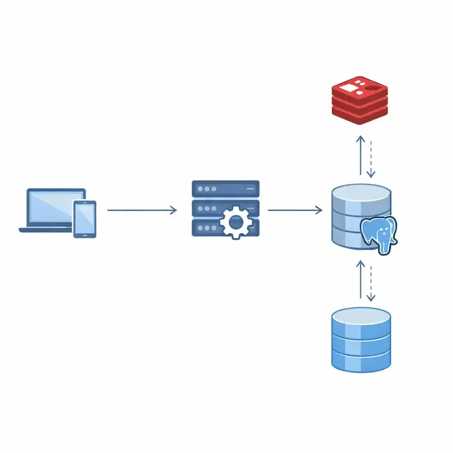
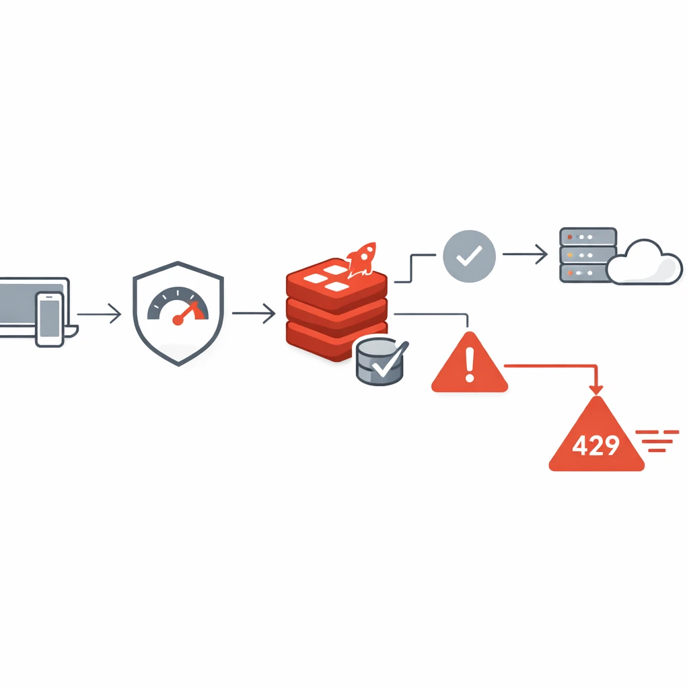

## Book Store API
پروژه‌ی Book Store یک سامانه‌ی مدیریت و فروش کتاب با معماری `NestJS` و پایگاه داده‌ی `PostgreSQL` است. این سیستم با هدف ساخت یک بستر ماژولار، امن و توسعه‌پذیر طراحی شده تا تمام فرآیندهای مرتبط با کتاب، سبد خرید، سفارش و پرداخت را به شکلی قابل نگهداری پوشش دهد.

## معماری کلی سیستم
ساختار پروژه بر پایه‌ی `Module-based Architecture` و اصل `Separation` of `Concerns` طراحی شده است. هر بخش دارای ماژول اختصاصی است:


### BooksModule
مسئول مدیریت کتاب‌ها. شامل افزودن، ویرایش، حذف و جست‌وجوی کتاب‌ها (بر اساس عنوان ، نویسنده ، ژانر و سال ‌انتشار ) است.

این ماژول به‌صورت مستقیم با پایگاه داده از طریق `TypeORM Repository` ارتباط دارد.

---
### GenresModule
برای دسته‌بندی کتاب‌ها و ارتباط میان کتاب و ژانر ایجاد شده است. از روابط `ManyToOne` و `OneToMany` برای اتصال بین کتاب‌ها و ژانرها استفاده شده.

---
### CartsModule
مدیریت سبد خرید کاربران را بر عهده دارد. هر کاربر فقط یک سبد خرید فعال دارد و آیتم‌های آن در موجودیتی جداگانه (CartItem) ذخیره می‌شوند.

در این ماژول الگوریتم بین کتاب و سبد خرید به شکل زیر عمل می‌کند:

امکان افزودن کتاب به سبد، سیستم بررسی می‌کند آیا آیتم مربوطه قبلاً وجود دارد یا خیر.
اگر وجود داشته باشد، فقط تعداد آن (quantity) افزایش می‌یابد. در غیر این صورت یک رکورد جدید ساخته می‌شود.
قیمت هر آیتم مستقیماً از کتاب خوانده می‌شود تا تغییر قیمت کتاب همیشه به‌روز باشد.

---
### OrdersModule
منطق ثبت سفارش را مدیریت می‌کند و مستقیماً با CartsService و PaymentService تعامل دارد.

الگوریتم بین سبد خرید و سفارش:

هنگام ثبت سفارش، سیستم ابتدا وضعیت سبد را بررسی می‌کند. اگر خالی باشد، خطا بازمی‌گرداند.
سپس سفارش اولیه با وضعیت `pending` ساخته می‌شود.
آیتم‌های سبد خرید به `OrderItem` تبدیل شده و مبلغ کل جمع می‌شود.
در نهایت، با ارسال مبلغ نهایی به `PaymentService` وضعیت سفارش تعیین می‌شود (`completed` در صورت موفقیت).

---
### PaymentService
یک لایه‌ی انتزاعی برای فرآیند پرداخت که از یک `MockPaymentProvider` استفاده می‌کند. این طراحی باعث می‌شود در آینده درگاه بانکی واقعی با کمترین تغییر اضافه شود.

---
### AuthModule و UserModule
مسئول احراز هویت و مدیریت کاربران هستند. از JWT برای احراز هویت استفاده شده و سطح دسترسی‌ها بر اساس نقش کاربر (Normal User /Premium User /Moderator  / Admin) طراحی شده‌اند.
سطح دسترسی کاربران:

#### `Normal User`: قابلیت مشاهده کتاب‌ها، افزودن به سبد خرید، ثبت سفارش عادی.
#### `Premium User`: علاوه بر قابلیت‌های Normal User، از تخفیف‌های ویژه در خرید بهره‌مند می‌شود.
#### `Admin`: دسترسی کامل به مدیریت کل سیستم شامل کتاب‌ها، ژانرها، کاربران و سفارش‌ها.
#### `Moderator`: قابلیت مدیریت محتوا (کتاب‌ها و ژانرها) و نظارت بر سفارش‌ها، اما بدون دسترسی به اطلاعات حساس کاربران یا تغییر نقش‌ها.
---
### IpTrackerModule (Rate Limiting بر اساس IP)
این ماژول از Redis برای کنترل تعداد درخواست‌های کاربران بر اساس IP استفاده می‌کند.

### مزایا:
#### بسیار سریع‌تر از ذخیره در دیتابیس
#### بدون نیاز به کوئری‌های سنگین
#### عملیات Atomic
#### TTL خودکار برای پاک شدن رکورد پس از زمان تعیین‌شده
#### برای هر IP، تعداد درخواست‌ها در Redis شمرده می‌شود. در صورت عبور از حد مجاز، خطای 429 برمی‌گردد.

## گاردهای امنیتی (Guards):
برای حفاظت از مسیرها، از `JwtAuthGuard` استفاده شده است تا فقط کاربران احراز‌شده بتوانند درخواست‌های حساس ارسال کنند. برای تمایز بین سطوح دسترسی مختلف (مانند `Admin،` `PremiumUser` و `NormalUser`)، از `RolesGuard` استفاده شده است. مسیرهایی که نیاز به احراز هویت ندارند (مانند ثبت‌نام یا مشاهده عمومی کتاب‌ها) با دکوراتور `@Public()` مشخص شده‌اند.


## علت استفاده از PostgreSQL:
با توجه به ماهیت پروژه‌ی Book Store که شامل روابط پیچیده بین موجودیت‌هاست (کتاب‌ها، ژانرها، سبد خرید، سفارش‌ها، کاربران) و نیاز به تضمین یکپارچگی داده‌ها (مثلاً اطمینان از اینکه یک سفارش به‌درستی ثبت شود و سبد خرید پس از آن پاک گردد)، یک پایگاه داده‌ی SQL  گزینه‌ای پایدار، قابل اعتماد و توسعه‌پذیر برای این پروژه محسوب می‌شود.

## 🧨 Redis Integration
پروژه از Redis برای دو کار مهم استفاده می‌کند:

1) Cache برای BooksService
برای کاهش فشار روی PostgreSQL، لیست کتاب‌ها در Redis ذخیره می‌شود.

از الگوی Cache-Aside استفاده شده:

ابتدا تلاش برای خواندن کش
اگر نبود → اجرا کردن query
ذخیره نتیجه در Redis
بازگشت پاسخ
کش هنگام ایجاد/ویرایش/حذف کتاب، به‌صورت خودکار invalidate می‌شود.
<p align="center">
  
</p>


2) Rate Limiting
با Redis ریکوئست‌ها با سرعت بسیار بالا شمارش می‌شوند.

متد INCR در Redis تضمین می‌کند که شمارش کاملاً Atomic باشد.

<p align="center">
  
</p>
## مستندسازی API با Swagger
برای مستندسازی و تست راحت‌تر Endpointها، Swagger روی پروژه فعال شده است.

- پس از اجرای پروژه، مستندات Swagger از طریق آدرس زیر در دسترس است:
```text
http://localhost:3000/api
```

## فرآیند ثبت سفارش:
#### 1.بررسی فعال بودن و پر بودن سبد خرید کاربر
#### 2.ایجاد سفارش اولیه با وضعیت pending
#### 3.انتقال آیتم‌ها از Cart به OrderItem
#### 4.محاسبه مبلغ تخفیف برای کاربران ویژه
#### 5.محاسبه مبلغ کل و ارسال به PaymentService
#### 6.دریافت نتیجه پرداخت و تغییر وضعیت سفارش
#### 7.پاک‌سازی سبد خرید کاربر پس از تکمیل موفق تراکنش

---
## بهبودهای آینده
#### استفاده از Redis Cache برای بهبود سرعت پاسخ به درخواست‌های پرتکرار
#### برسی موجودی کتاب برای جلوگیری از فروش کتاب‌های ناموجود
#### پیاده‌سازی Unit Testing و E2E Tests برای ماژول‌ها

## نحوه‌ی اجرا:
```
 npm install
```
####  تنظیم فایل .env برای اتصال به PostgreSQL و JWT_SECRET
```
 npm run start:dev
```


